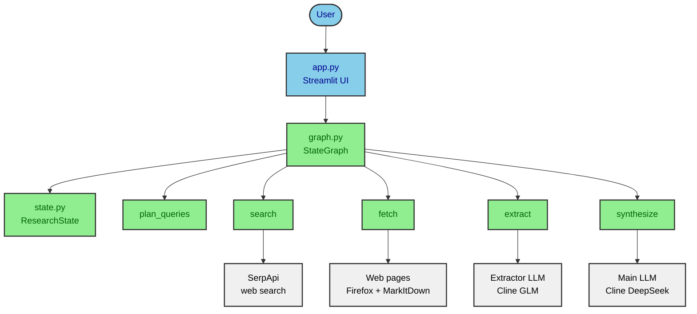
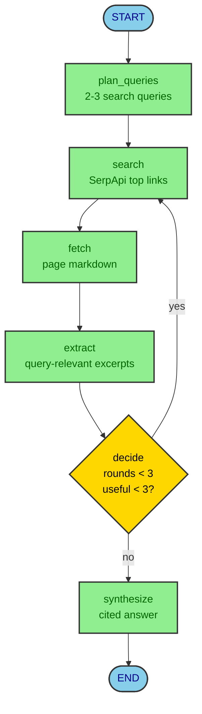
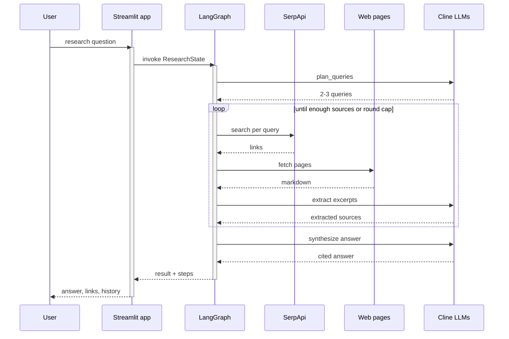

# Dara-Chat

# Research Harness — local research agent (LangGraph + Streamlit)

> Status: phase 3 (Streamlit UI with live progress + sidebar history).

Small local Perplexity-like: user topic -> planned queries -> SerpApi search ->
Playwright Firefox + MarkItDown fetch -> secondary-model extraction ->
capped `decide` loop (`MAX_ROUNDS=3`) -> cited answer in Streamlit.

## Setup

```bash
make install
cp .env.example .env   # fill SERPAPI_API_KEY etc.
```

`pyproject.toml` uses the Aliyun PyPI mirror as default index because
`files.pythonhosted.org` DNS is unreachable from this network. To use stock
PyPI, delete the `[[tool.uv.index]]` block or set `UV_DEFAULT_INDEX`.

Needs: Python >= 3.13, `uv`, Firefox browser files (`make install` fetches them).

## Make commands

- `make install` — `uv sync` + Playwright Firefox
- `make test` — offline `pytest` (no network/services)
- `make run` — Streamlit UI (from phase 3)

## Structure

- `src/research_harness/config.py` — caps, timeouts, env key names
- `src/research_harness/state.py` — shared `ResearchState`
- `src/research_harness/graph.py` — LangGraph wiring (phase 1)
- `src/research_harness/tools.py` — search/fetch/extract (phase 2)
- `src/research_harness/app.py` — Streamlit UI (phase 3)
- `src/research_harness/history.py` — sidebar history helpers
- `tests/` — offline harness tests

### System architecture



## Graph flow

`plan_queries -> search -> fetch -> extract -> decide`
(`decide -> search` while info is thin and `rounds < MAX_ROUNDS`,
else `-> synthesize -> END`; on cap with thin info the answer states the limit.)



## Run sequence

One research run, from question to answer (live step updates included):



## Known limits

- Fetch keeps bounded markdown per page; big pages are truncated.
- Web content is treated as data only; in-page instructions are ignored.
