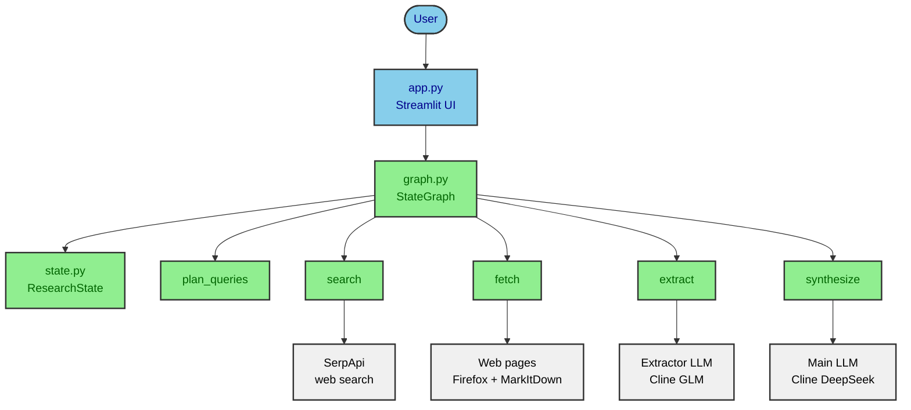
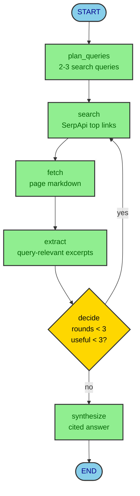
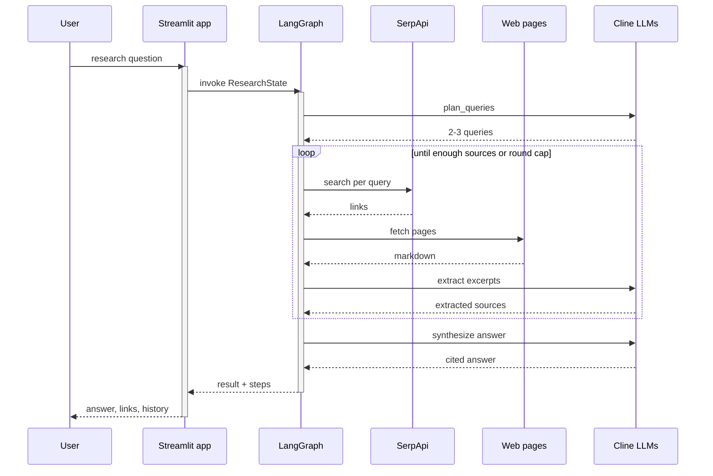

# Architecture

Short map of the research harness: components, graph flow, and one full run.
Sources: `src/research_harness/graph.py`, `state.py`, `tools.py`, `app.py`, `config.py`.
Diagram sources live in `docs/diagrams/` (`.mmd` files).

## Components

| Component | File | Role |
|-----------|------|------|
| Streamlit UI | `app.py` | Hero search, live step status, Answer/Links tabs, sidebar history |
| Graph wiring | `graph.py` | `StateGraph` nodes + `decide_router` stop rule |
| Shared state | `state.py` | `ResearchState`: question, queries, fetched, extracted, rounds, answer |
| Tool nodes | `tools.py` | SerpApi search, Firefox/MarkItDown fetch, LLM extract/synthesize |
| History helpers | `history.py` | Newest-first cap, entry labels, delete |
| Caps | `config.py` | `MAX_ROUNDS=3`, `MIN_USEFUL_SOURCES=3`, char budgets, timeouts |

## Graph flow

## One run, end to end

